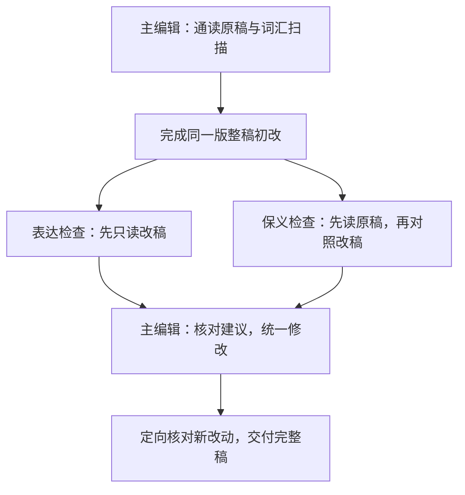

<p align="center">
  
</p>
<p align="center">
  <strong>有真意，去粉饰，少做作，勿卖弄。</strong><br>
  <sub>——鲁迅《作文秘诀》</sub>
</p>
<p align="center">
  <a href="#一分钟开始"></a>
  <a href="#改稿示例"></a>
  <a href="#适用范围"></a>
</p>

# EasyUnslop

EasyUnslop 帮助你润色已有的中英文论文和专业文本：删去空泛套话，理顺句子和段落，让读者更容易理解你的主张及其依据。编辑范围包括论文题名、各级节标题、摘要、正文，以及所提供的图注和表注。

修改从原稿和你提供的上下文出发。句子可以重写，段落可以在授权范围内重新安排；专业术语、研究结论、必要限定和作者声音随改稿一并核对。已经清楚、自然的文字可以保留。

## 编辑方法

### 围绕读者理解修改

去掉 AI 腔之后，句子仍可能主干不清、修饰含混，段落也可能缺少承接。EasyUnslop 会继续处理这些问题：让条件靠近所限定的内容，让比较沿同一维度展开，让每段承担清楚的任务。词句模式、词汇报告与案例提供检查线索，是否改动取决于具体语境。

### 充分改写表达，逐项核对含义

改善表达的同时，核对作者说了什么、凭什么这样说。例如，“控制水深后呈负相关”须保留模型条件与关联性质；“每周提交比例”须保留统计窗口；数学命题中的量词次序、规范论证中的“应当”，也须在改写中保留。技术信息可以换位置、另成句，核对范围包括主张、条件、数字口径、动作状态和引用归属。

### 先组织信息，再精修句子

全文编辑先看各节如何推进核心问题，再处理段落与语句。长稿结构难跟随时，先用简短的反向提纲概括各段主题与职责，找出前提出现过晚、非相邻段落重复等问题。在同一节内，可以调整句序、分合相邻段落、合并重复说明；跨节重排遵照你的结构编辑要求。摘要、结果与讨论对同一发现承担不同任务，按用途保留必要重复。

文献段根据所给研究的问题、方法或结果组织共同点和分歧，保留各自条件与引用。正文与图表也有分工：正文交代关键比较，图注和表注利用已有材料说明对象、单位、符号和误差含义。编辑长稿时，记录术语、数值口径和前后关联，完成后检查题名、摘要、正文与结论的对应。

### 根据学科和文体保留表达

专业术语、缩写、被动句、名词化和长句按用途保留。中文检查搭配、指代与信息承接；英文还结合实际指称校改冠词、可数性、修饰结构和时态。句间衔接优先靠清楚的主题与关系，连接词按需使用。

原稿中写得好的段落和你提供的样稿，可以作为语气、人称及展开方式的参照。改稿保留作者已有的批评、让步、规范要求与合理强调，结尾也沿着已有论述收束。样稿中的事实、观点和引文留在样稿中。

### 用词频与词库定位需要检查的表达

全文润色在初改前扫描稿内高频词、重复词组和[AI倾向词与常见表达候选库](references/lexical-signals.json)。报告给出次数、位置、上下文和保留条件；有同语言、同文体的参照稿时，还会比较归一化频率，帮助发现异常集中的用词。混合稿分别统计中英文：中文使用二三元字组，英文统计实词及二三元词组。常见行内强调保留词组连续，代码、公式与参考文献从正文统计中剔除。

主编辑据此检查重复、空泛修饰和不准确的搭配，再作修改。`robust regression`、系统性误差、闭环控制等专业表达按含义保留。词库分别标注文献研究、社区观察、本地记录和编辑模式；模型标签保留原有研究或观察范围。修改后复扫相关候选，再核对上下文，具体用法见[词汇诊断](references/lexical-diagnostics.md)。

这些方法结合了专业编辑中的原意与语域保持、科学写作中的读者预期，以及写作认知研究中的规划、表达与复核。具体来源见[方法依据](#方法依据)和[采用记录](references/sources.md)。

## 全文如何分轮协作

**一位主编辑统稿，两位检查者分别关注表达与原意。** 在支持子代理的环境中，全文润色默认执行以下流程：



两位检查者在独立上下文中检查同一版整稿，先不接收主编辑的修改理由或对方意见。表达检查者寻找阅读障碍、段落跳跃和生硬压缩；保义检查者核对含义、术语、数据、限定、引用及文档结构。

表达检查者完成独立阅读后，再结合词汇候选检查遗漏的重复。检查意见需要指出具体位置、问题和依据。主编辑回查稿件是否已有答案：答案位置难找时改善承接，答案清楚时可以说明依据后保留原文。主编辑决定采纳、调整后采纳或不采纳，统一全文声音，再核对新改动及关联段落。具体问题解决后就交付。

**短段、单个标题和轻度校改默认由同一编辑者完成。** 你的协作要求优先；只能同时启动一位检查者时，依次进行表达检查和保义检查；没有代理工具时，由主编辑依次完成单读改稿与原文对照。日常使用默认只收到一份完整改稿，对照与理由可另行要求。详细交接和停止条件见[分轮编辑与协作](references/editorial-workflow.md)。

## 一分钟开始

让所用 Agent 安装技能：

```text
请帮我安装这个 skill：
https://github.com/Rimagination/easyunslop
```

提供整篇稿件时，可以这样调用：

```text
请用 $easyunslop 润色这篇论文，包括题名、各级节标题、摘要与正文。
可以在同一节内调整句序和分合段落，保持专业含义、证据强度与作者风格。
直接给出完整改稿。

[粘贴稿件或提供文件]
```

只想轻校一段文字时：

```text
请用 $easyunslop 对以下段落做轻度校改，保留句序、专业术语和原有判断。
清楚的句子可以保留。直接给出改稿。

[粘贴段落]
```

你也可以单独请求修改标题或摘要。提供相关正文，有助于准确判断标题范围和摘要重点；提供同文体的参考稿，可以参照作者声音并比较词频。需要了解取舍时，可要求“列出主要改动及简短理由”。

<details>
<summary>手动安装</summary>

进入所用工具实际读取的 skills 目录，执行：

```sh
git clone https://github.com/Rimagination/easyunslop.git easyunslop
```

安装后的 `easyunslop` 文件夹应直接包含 `SKILL.md`、`agents/` 和 `references/`。若 Codex 设置了自定义 `CODEX_HOME`，请使用该路径下的 `skills` 目录。其他工具请确认其技能目录。

通过克隆安装的已有用户，可在技能目录中执行 `git pull` 获取后续更新。词汇扫描使用现有Python 3和标准库，无需第三方包。环境没有Python时，编辑仍可按词库和模式完成；工具统计的使用方式见[词汇诊断](references/lexical-diagnostics.md)。

</details>

## 改稿示例

先看本轮全文试跑中的地球与环境片段。研究与数据均为**自编模拟材料**，用于展示编辑动作；完整执行情况见[更新与试用记录](docs/workflow-update-20261023.md)。

### 地球与环境：理顺计算过程，保留专业信息

**原文**

> 对在2025年6月2日至8月24日的12周监测中获得的记录，先筛选达标周，再计算各站点每日当地时间08:00—18:00的平均水温，随后对这些日均值取平均，作为站点白昼平均水温用于分析。线性混合模型以该水温为响应变量，纳入冠层覆盖率和水深，并设置湖泊随机截距。

**改文**

> 监测时间为2025年6月2日至8月24日，共12周。首先筛选各站点的达标周，计算其中每日当地时间08:00—18:00的平均水温，再对这些日均值取平均，得到用于分析的站点白昼平均水温。线性混合模型以该水温为响应变量，纳入冠层覆盖率和水深，并设置湖泊随机截距。

时间范围独立成句后，计算过程更容易跟随。达标周筛选、日均值计算和进一步取平均的顺序保留，模型设定也完整保留。

后续检查还发现另一处月平均水温沿用了全期指标的简称，主编辑据上下文修正了名称，详见[检查意见及处理](docs/workflow-update-20261023.md#检查意见如何落实)。

<details>
<summary>传播研究：用正文已有发现组织摘要</summary>

**原摘要**

> 本研究围绕网络辟谣情境下的信息核查行为展开深入探讨，通过对社区居民进行访谈，系统考察了信息来源选择及其背后的意义。文章将讨论社区居民如何使用社区通知与熟人求证，以及两类来源在日常信息核查中的不同作用。本研究具有一定的理论意义和实践价值。

**同时提供的正文**

> 本研究访谈了24名社区居民。多数受访者会同时查看社区通知并向熟人求证。受访者通常通过社区通知确认是否存在相关安排，通过熟人求证理解这些安排与自身生活的关系。少数受访者主要依靠社区通知。本文据此区分了安排确认与情境解释两类核查任务。

**改后的摘要**

> 本研究通过访谈24名社区居民，考察网络辟谣情境下的信息来源选择及其作用。多数受访者会同时查看社区通知并向熟人求证。受访者通常通过社区通知确认是否存在相关安排，通过熟人求证理解这些安排与自身生活的关系。少数受访者主要依靠社区通知。本文据此区分了安排确认与情境解释两类核查任务。

该例也是自编材料，来自[早期编辑记录](docs/outputs.md)。改稿用正文已有的样本、发现和两类核查任务替换议程预告与空泛评价。

</details>

更多改稿、原句保留及误改复盘，见[33条编辑实例与失败复盘](references/editing-examples.md)。新增实例涵盖反向提纲、信息承接、英文语法、文献段组织、图注和作者立场。

## 适用范围

| 稿件或任务 | 编辑重点 |
| --- | --- |
| 中英文论文、学位论文 | 题名、节标题、摘要与正文的表达及相互对应 |
| 经验研究与计算研究 | 比较对象、模型条件、统计口径、观测与推断的区别 |
| 理论、形式与规范论证 | 概念边界、量词、否定范围、推理层次和判断强度 |
| 人文阐释与专业评论 | 观点归属、引语、分析视角、段落推进和作者声音 |
| README 与其他专业说明 | 读者需要先知道什么，功能是否具体，开头与段落是否顺畅 |
| LaTeX 与 Markdown 稿件 | 润色标题、图注和正文中的自然语言，保持公式、引用键、标签、链接目标与代码完整 |

编辑依据是已有稿件及所提供的上下文。补充文献、研究设计和事实核验属于另外的任务；影响解释的既有研究限制随相关主张保留。材料未提供某项检验时，不据此写成“本研究未进行该检验”。

## 案例与方法依据

### 从具体修订中学习取舍

[真实论文案例库](references/real-editing-cases.md)收录10篇论文的公开版本、评审或作者回复，覆盖教育、神经科学、计算机科学、数学、语言学，以及地球与环境领域的海洋碳循环、古海洋地球化学。案例用于说明怎样判断概念范围、信息位置、符号解释、比较对象及时间尺度。

另有[5组原稿—改稿对照](references/editorial-pairs.md)，区分职业编辑稿、专家建议、改编教学例和作者实际修订。来源已说明的理由与本项目分析分别标注，建议稿保留其原始身份。

### 方法依据

| 依据 | 在 EasyUnslop 中的采用方式 |
| --- | --- |
| [Editors Canada：专业编辑标准](https://editors.ca/wp-content/uploads/2024/05/EditorsCanada_ProfessionalEditorialStandards_2024.pdf) | 根据受众、任务与修改幅度编辑，保持原意、作者声音和语域。 |
| [Gopen 与 Swan：科学写作与读者预期](https://www.ugrad.stat.ubc.ca/~nancy/writing/gopen_swan.pdf) | 处理主干、修饰范围、上下文与信息重心，使专业内容更容易理解。 |
| [Flower 与 Hayes：写作的认知过程](https://publicationsncte.org/content/journals/10.58680/ccc198115885) | 按具体问题调用规划、表达和复核；发现问题时回到对应层次修改。 |
| [Purdue OWL](https://owl.purdue.edu/owl/general_writing/academic_writing/conciseness/index.html) 与 [Academic Phrasebank](https://www.phrasebank.manchester.ac.uk/about-academic-phrasebank/) | 删去冗余，同时保留承担实际交际功能的学术表达。 |
| [Wisconsin：反向提纲](https://writing.wisc.edu/handbook/processandstructure/reverseoutlines/)、[George Mason：信息承接](https://writingcenter.gmu.edu/writing-resources/grammar-style/improving-cohesion-the-known-new-contract) | 检查段落职责、前提位置与句间主题，区分必要复现和无信息重复。 |
| [George Mason：学术时态](https://writingcenter.gmu.edu/writing-resources/grammar-style/the-three-common-tenses-used-in-academic-writing)与[ICMJE：稿件准备](https://www.icmje.org/recommendations/browse/manuscript-preparation/preparing-for-submission.html) | 按论述功能检查时态，用已有材料明确图表说明；学科格式按各自要求执行。 |
| [多模型讨论的理论研究](https://proceedings.neurips.cc/paper_files/paper/2024/hash/32e07a110c6c6acf1afbf2bf82b614ad-Abstract-Conference.html) | 相近模型可能共享误解，因此要求检查者给出文字依据，由主编辑核实建议。 |
| [Juzek与Ward：词汇过度代表](https://aclanthology.org/2025.coling-main.426/)与[超额词研究的原始项目](https://github.com/berenslab/llm-excess-vocab) | 以词频和重复词组定位候选，保留研究范围，再回到句段判断是否需要修改。 |

这些研究为设计提供参考。全文协作通过不同材料和阅读任务改变检查重点，其实际作用记录在具体改稿中。

## 更新与验证记录

2026-10-23的更新完成了13项编辑行为核对，并实际试跑全文协作、英文短段轻校和模拟无代理工具三条路径。全文试跑落实三处后续修改；英文轻校保留了全部四句；最终综合检查未发现影响交付的问题。各项材料身份及结果见[更新与试用记录](docs/workflow-update-20261023.md)。

随后接入词汇扫描，新增工具自检和一次独立使用试跑。执行者按新版技能实际扫描原稿与改稿，修改了`utilized`、`delve`所在的句子及重复评价，保留了`robust regression`、`systematic error`及全部数据和条件。原稿、改稿与候选取舍见[词汇诊断验证记录](docs/lexical-validation-20261023.md)。

早期的[四例无技能／有技能对照](docs/transfer-evaluation.md)保留了原输出与匿名代理评阅，后续复核撤回了其中一例的原评价，并将问题用于修正规则。历史记录与更正一并保留。

本次综合补充接入反向提纲、信息承接、英文语法与时态、图注分工和立场核对等方法，新增8个教学例，并修复混合语言和常见格式的统计遗漏。新版已实际用于中文行政法论证及英文地球环境稿，原稿、终稿和执行情况见[综合补充与验证](docs/comprehensive-update-20261023.md)。

质量判断关注含义是否保持、既有信息是否更易理解、清楚的原句是否得到保留。公开论文修订、实际改稿和作者或读者反馈都能提供依据；AI检测分数、删词数量和代理的一致意见不作质量结论。

## 项目文档

| 文档 | 内容 |
| --- | --- |
| [SKILL.md](SKILL.md) | 入口、任务范围、内容约束和编辑判断 |
| [分轮编辑与协作](references/editorial-workflow.md) | 分工、交接材料、意见整合、工具适配与停止条件 |
| [词汇诊断](references/lexical-diagnostics.md)与[候选词库](references/lexical-signals.json) | 高频词、重复词组、参照词频、上下文及保留条件 |
| [编辑模式库](references/editing-patterns.md) | 词句、比较关系、信息次序与段落组织的具体处理 |
| [编辑实例与失败复盘](references/editing-examples.md) | 33条实例，包含结构、衔接、语法、标题、图注及常见误改 |
| [真实论文修订](references/real-editing-cases.md) | 10篇公开论文的版本、来源、定位与适用条件 |
| [原稿—改稿对照](references/editorial-pairs.md) | 5组短对照、修改理由和容易改坏的写法 |
| [来源与采用记录](references/sources.md) | 参考项目、专业编辑资源和采用范围 |
| [本轮更新与试用](docs/workflow-update-20261023.md) | 集中修订、全文协作及轻量分支的实际记录 |
| [词汇诊断验证](docs/lexical-validation-20261023.md) | 工具自检、真实调用记录及模拟稿前后对照 |
| [综合补充与验证](docs/comprehensive-update-20261023.md) | 专业写作方法、AI写作偏差、格式与混合语言修复及本轮实际试用 |
| [早期验证记录](docs/validation.md) | 初始版本检查及后续修订索引 |

## 来源与致谢

EasyUnslop 由 scansci-write 的语言修订规则整理而来，并参考了 [Humanizer-zh](https://github.com/op7418/humanizer-zh)、[qu-ai-wei](https://github.com/LifelongLazyLearner/qu-ai-wei)、[academic-writing-refiner](https://github.com/Zihan-Zhu/academic-writing-refiner)、[humanizer](https://github.com/blader/humanizer)、[humanizer.tw](https://github.com/yelban/humanizer.tw)、[stop-slop](https://github.com/hardikpandya/stop-slop) 和 [anti-defensive-writing](https://github.com/Adkid-Zephyr/anti-defensive-writing-Skill) 等社区项目。

公开修订材料来自 ARIES、arXivEdits，以及 F1000Research、eLife、ESSD、Biogeosciences 等论文版本与评审记录。具体来源及取舍见[采用记录](references/sources.md)。第三方作品保留各自的权利和许可，完整原文请访问原始来源。
