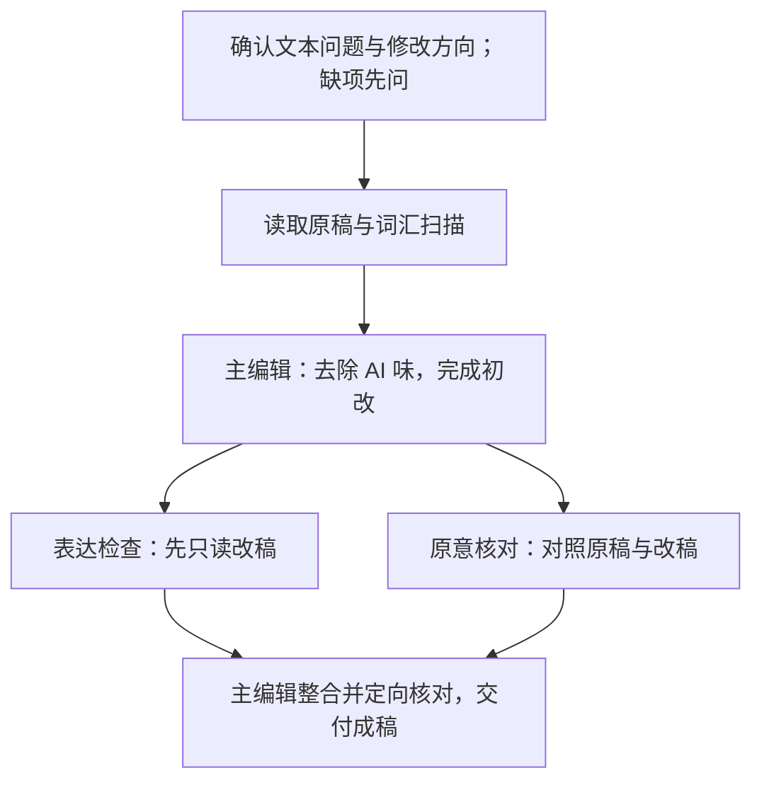

<p align="center">
  
</p>
<p align="center">
  <strong>有真意，去粉饰，少做作，勿卖弄。</strong><br>
  <sub>——鲁迅《作文秘诀》</sub>
</p>
<p align="center">
  <a href="#一分钟开始"></a>
  <a href="#改稿示例"></a>
  <a href="#任务范围"></a>
</p>

# EasyUnslop

EasyUnslop 是一个用于**去除中英文文本中 AI 味**的 skill。它从已有稿件出发，清理套话、黑话、机械铺陈和生硬表达，让文字读起来自然，同时保留原意、专业术语和作者风格。

论文、专业报告、技术说明和其他已有文本都可以处理。生硬句子可以重写，无信息的重复可以合并。改写后对照原文核对专业含义与判断力度，原本写得好的地方可以保留。

## 一分钟开始

让所用 Agent 安装技能：

```text
请帮我安装这个 skill：
https://github.com/Rimagination/easyunslop
```

然后提供想修改的文字：

```text
我觉得下面的文字套话和重复较多，读起来生硬。
请用 $easyunslop 压缩套话与重复，理顺句段。
保留原意、专业术语、证据强度与作者风格，保持原有的专业程度。
可以改写生硬句子、合并重复表达。直接给出改稿。

[粘贴文字或提供文件]
```

可以指定只改一段，也可以提供整篇稿件，包括题名、节标题、摘要、正文及图表说明。需要了解取舍时，再要求列出主要改动；只想轻校时，说明保留句序和段落组织即可。

改稿前，skill 会确认你认为文本存在哪些问题、希望怎样修改。缺哪一项就先问哪一项，收到答复后再改；本次或此前对话已经说清的无需重复确认。

<details>
<summary>手动安装与更新</summary>

在所用 Agent 实际读取的 skills 目录中执行：

```sh
git clone https://github.com/Rimagination/easyunslop.git easyunslop
```

安装后的 `easyunslop` 文件夹直接包含 `SKILL.md`、`agents/`、`references/` 和 `scripts/`。通过克隆安装的用户，可在该目录执行 `git pull` 更新。

词汇扫描使用 Python 3 标准库，无需第三方包。没有 Python 时，仍可按词库、模式和原文完成编辑。具体用法见[词汇诊断](references/lexical-diagnostics.md)。

</details>

## 改稿示例

下面两例均选自网友公开贴出的中文 ChatGPT 输出，来源页面明确说明了生成过程。原文按来源节选，EasyUnslop 改稿与具体改动列在其后。

### 人文社科·教育与就业：合并重复判断

来源：[网友分享的学历与就业讨论](https://www.reddit.com/r/China_irl/comments/1pdw2mv/)。发帖者 TimelyDiscipline8159 明确说明让 ChatGPT 回答了三次，并逐次贴出全文。以下节选自第三次回答的“1. 学历的价值”。

**网友贴出的 ChatGPT 原文（节选）**

> 然而，学历提升并不总是等于更好的就业前景。对于绝大多数行业，尤其是商业和技术领域，企业更看重的是实际工作能力和经验，而不仅仅是学历。很多时候，企业招聘时并不单纯依赖学历，而是更看重求职者的工作能力、实战经验以及是否能快速融入团队和公司文化。

**EasyUnslop 改稿**

> 学历提升并不总是等于更好的就业前景。在绝大多数行业，尤其是商业和技术领域，企业招聘时往往更看重求职者的实际工作能力与经验，以及能否快速融入团队和公司文化。

合并两次“更看重能力与经验”的重复表述。保留就业前景、招聘偏好、行业范围及团队适应等信息，“并不总是”“往往”继续限定判断。

### 理工科·网络技术：直接陈述技术特性

来源：[Blanboom 公开分享的 L4S 生成记录](https://blanboom.org/2023/learning-l4s-with-chatgpt/)。作者说明自己让 ChatGPT 生成介绍 L4S 的电子书，并公开了提示词、生成正文和对话链接。以下节选自首次生成结果的技术介绍部分。

**网友贴出的 ChatGPT 原文（节选）**

> L4S的另一个重要特性是其可扩展的拥塞控制算法，它允许在高速网络中保持高吞吐量。

**EasyUnslop 改稿**

> L4S 采用可扩展的拥塞控制算法，可在高速网络中保持高吞吐量。

把“另一个重要特性是其……”改为直接陈述。保留“可扩展的拥塞控制算法”“高速网络”“高吞吐量”，以及原文表示能力的语气。

更多专业表达的保留条件与误改复盘，见[34条编辑实例](references/editing-examples.md)。这些实例分别标注自编材料、实际项目改稿及公开修订来源。

## 它会处理哪些 AI 味

| 常见表现 | 编辑动作 |
| --- | --- |
| 宏大背景、空泛开场、反复宣称意义 | 进入原稿已有主题，压缩没有新增信息的铺垫与评价。 |
| “赋能”“抓手”“深度洞察”等词代替具体内容 | 从原文找出实际功能、动作和对象，写清楚它们。 |
| 同一判断换词复述，每段都统一拔高 | 比较各处有没有新信息和新任务，合并无作用的重复。 |
| 机械转折、排比凑数、相同的开头与结尾 | 按原有逻辑调整句段，让每句承担实际任务。 |
| 句子生硬、指代漂移、修饰语与对象错位 | 重写妨碍理解的句法，理顺搭配与承接。 |
| “根据你的要求”“你的观点凸显了”等聊天残留 | 在成稿中直接表达实质内容。真实引语及研究材料按其身份保留。 |

词表命中和句式相似都只是检查线索。`robust regression`、系统性误差、闭环控制等术语，以及必要的被动句、名词化和长句，按用途保留。详细取舍见[编辑模式库](references/editing-patterns.md)。

## 怎样在去 AI 味时保持质量

**先问清问题与方向。** 用户尚未说明时，改稿前先询问；用户希望先听诊断时，先列出具体问题供其确认方向，再动笔。术语变少、句子变短、词库清零都不能单独说明改好了。

**发现夸大疑虑，先讨论具体改动。** 目标与成果承诺也需要检查。“发表”改为“投稿”、减少成果数量、删除软件功能或缩小交付范围，都须先确认。作者决定哪些目标调整、哪些保留；正常的高目标与专业要求不会因去 AI 味而自动降格。

**充分改写句法，逐项核对含义。** 条件、量词、否定范围、数字口径、引用归属与作者立场随实际改动检查。“相关”保留关联性质，“应当”保留规范力度，计划继续写成计划；批评、让步和合理强调按原意保留。

**读完整句段，再用统计查漏。** 全文处理会扫描高频词、重复词组和[候选词库](references/lexical-signals.json)，结合上下文选择修改。中英文混合稿分别统计；有同语言、同文体参照时，可比较归一化频率。词库区分文献研究、社区观察和本地编辑记录，具体范围见[词汇诊断](references/lexical-diagnostics.md)。

## 全文处理流程

一位主编辑统稿，表达与原意分别检查。整篇稿件在支持子代理的环境中采用以下流程：



两位检查者在独立上下文中处理同一版稿件，先不接收主编辑理由或彼此意见：一位检查文字是否自然、连贯，另一位检查改写是否改变含义。主编辑核实具体意见后统一修改，避免多轮润色改变作者风格。

短段、单个标题和轻度校改默认由同一编辑者完成。没有子代理工具时，依次读改稿、对照原文；具体问题解决后交付。详细交接见[分轮编辑与协作](references/editorial-workflow.md)。

## 任务范围

EasyUnslop 接收已有文字，完成去 AI 味所需的措辞、句法与句段调整，并核对修改是否保留原意。论文题名、节标题、摘要和图注同样可以处理；也可以只诊断问题，暂不改稿。

| 你的请求 | 如何处理 |
| --- | --- |
| “去掉这段的 AI 味”“减少机器腔” | 识别为相关请求；改稿所需的问题或方向尚未说明时，先问清再改。 |
| “上一版太假、太官方、像模板，不像我写的” | 沿用当前对话中可见的上一稿，不要求重贴；修改方向不足时只问缺失项。 |
| “只告诉我哪里有 AI 味，先别改” | 给出问题位置、文字依据和建议方向，保留有功能的专业表达，不输出改稿或生成概率。 |
| 纯纠错、翻译、排版、摘要、扩缩写或风格模仿 | 没有去 AI 味要求时不自动介入；明确点名且只需轻校时遵守指定范围。 |
| 从零写作、编写写作 prompt、研究审稿及代码、数据或图片任务 | 按原任务处理，不自动附加去 AI 味。混合任务仅处理明确需要编辑的自然语言。 |

触发技能与开始改稿分开判断。只诊断可以直接进行；开始改稿前，仍须确认文本问题与修改方向。通过 AI 检测或降低检测分数不作为本技能的任务与效果指标。

对可能夸大的目标与成果承诺，skill 会指出具体位置并询问修改方向。研究内容与目标的取舍由作者确认，skill 按确认范围编辑。

**选题与研究设计、从零撰写论文、补充文献或实验、事实核验、学术审稿，不属于本 skill 的任务。** 表达检查和原意核对服务于改稿质量；研究是否成立、论据是否充分等问题，由相应的研究与审稿任务判断。

## 案例、来源与验证记录

| 文档 | 内容 |
| --- | --- |
| [SKILL.md](SKILL.md) | 去 AI 味的任务范围、编辑顺序与内容约束 |
| [编辑模式库](references/editing-patterns.md)与[编辑实例](references/editing-examples.md) | 按语境改写、保留专业表达及常见误改 |
| [词汇诊断](references/lexical-diagnostics.md)与[候选词库](references/lexical-signals.json) | 重复统计、候选位置、来源与保留条件 |
| [分轮编辑与协作](references/editorial-workflow.md) | 表达检查、原意核对与主编辑整合 |
| [真实论文修订](references/real-editing-cases.md)与[原稿—改稿对照](references/editorial-pairs.md) | 专业编辑取舍的参照，各自保留来源身份 |
| [来源与采用记录](references/sources.md) | 社区项目、写作资源与研究依据的采用范围 |
| [综合补充与验证](docs/comprehensive-update-20261023.md) | 方法接入、工具修复与整稿试用 |
| [整稿试用](docs/comprehensive-trial-20261023.md)与[词汇诊断验证](docs/lexical-validation-20261023.md) | 原稿、实际改稿与执行记录 |
| [早期无技能／有技能对照](docs/transfer-evaluation.md) | 历史输出、匿名代理评阅及后续更正 |

编辑效果看文字是否更自然、既有信息是否更易理解，以及含义和专业程度是否保持。案例和执行记录用于呈现具体取舍，不以 AI 检测分数、删词数量或代理一致意见作效果排名。

## 来源与致谢

**scansci-write**：EasyUnslop 的前身。本项目从其语言修订规则中整理出去 AI 味的独立入口，并沿用原意、术语、条件与证据强度的核对方法。

### 去 AI 味与语言编辑项目

- **[Humanizer-zh](https://github.com/op7418/humanizer-zh)**：参考文体优先的处理方式，保留正式程度、归因、必要限定及有功能的专业表达。
- **[qu-ai-wei](https://github.com/LifelongLazyLearner/qu-ai-wei)**：参考编辑边界、症状与改法对应、作者声音及改后关系核对。
- **[Doubao Human Signal](https://github.com/ahang1598/doubao-workbuddy-qwenwork-skills/tree/main/doubao/skills/doubao-human-signal)**：参考触发、不适用场景及只诊断入口的组织方式，保留 EasyUnslop 围绕已有文本和改稿前确认的范围。
- **[academic-writing-refiner](https://github.com/Zihan-Zhu/academic-writing-refiner)**：参考按章节与写作场合选择表达，以及修改幅度适配的方法。
- **[humanizer](https://github.com/blader/humanizer)**：参考常见 AI 表达模式、跨节套式、解释尾句和模糊权威的检查。
- **[humanizer.tw](https://github.com/yelban/humanizer.tw)**：对照语气匹配与个性化表达的处理方式，按具体文体取舍。
- **[stop-slop](https://github.com/hardikpandya/stop-slop)**：参考开场铺垫、商业黑话、重复强调、假转折与过程旁白的定位方法。
- **[anti-defensive-writing](https://github.com/Adkid-Zephyr/anti-defensive-writing-Skill)**：参考减少无信息的自我贬低与防御性铺垫；保留原稿真实的负面结果和必要限制。

### 词频工具、反馈方法与修订语料

- **[llm-excess-vocab](https://github.com/berenslab/llm-excess-vocab)**：参考超额词与跨语料词频比较的分析思路，用于定位需要回读的表达。
- **[slop-forensics](https://github.com/sam-paech/slop-forensics)**：参考单词、二元与三元词组的统计方式。
- **[friction](https://github.com/zhangchaodesign/friction)**：参考将读者反馈落实为具体表达问题的思路。
- **[Review Feedback Agent](https://arxiv.org/html/2504.09737)**：参考区分稿件缺少信息与已有信息未被理解的方法，用于整理语言修改意见。
- **[ARIES](https://github.com/allenai/aries)**：采用真实评审与段落修订的配对记录，分析具体改动及其依据。
- **[arXivEdits](https://github.com/chaojiang06/arXivEdits)**：采用论文版本间的编辑与句子对齐记录，检查删改是否涉及实质含义。

写作与编辑资源、公开论文版本、评审及职业编辑样稿的具体出处，见[来源与采用记录](references/sources.md)。README 的去 AI 味示例在各例中标明网友帖子及本项目改稿。第三方作品保留各自的权利和许可。
