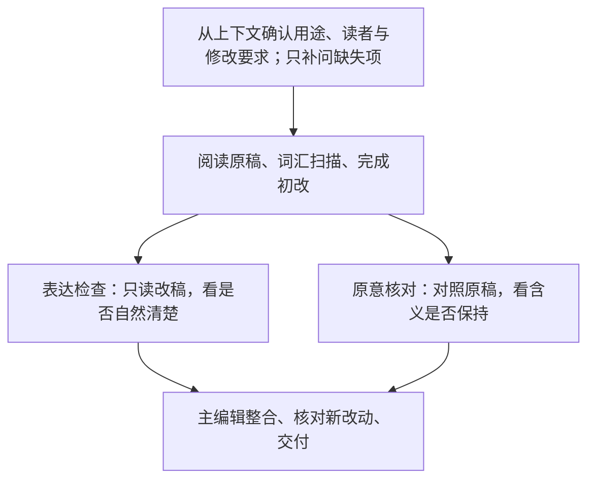

<p align="center">
  
</p>
<p align="center">
  <strong>有真意，去粉饰，少做作，勿卖弄。</strong><br>
  <sub>——鲁迅《作文秘诀》</sub>
</p>
<p align="center">
  <a href="#一分钟开始"></a>
  <a href="#改稿示例"></a>
  <a href="#任务范围"></a>
</p>

# EasyUnslop

EasyUnslop 用于**去除已有中英文稿件的 AI 味**。它清理套话、重复和生硬表达，理顺句段，同时保留原意、专业术语、判断力度与作者风格。

适用于论文、专业报告、技术说明和 README，也可处理题名、节标题、摘要及图注。你可以要求改稿，也可以先诊断问题。

## 一分钟开始

让所用 Agent 安装：

```text
请帮我安装这个 skill：
https://github.com/Rimagination/easyunslop
```

提供文字，并说明用途、读者和修改要求：

```text
这是一段给本领域同行看的专业报告，套话和重复较多。
请用 $easyunslop 压缩冗余、理顺句段，保持专业语气，
可以调整措辞与句序，保留原意、术语、判断力度与作者风格。

[粘贴文字或提供文件]
```

只想先看问题，可以说：“请用 $easyunslop 诊断这段哪里有 AI 味，先别改。”

改稿前，skill 会先从上下文确认两件事：**文字用在哪里、给谁看；希望重点改善什么、允许改到什么程度。** 信息齐全时直接改稿，有缺失时只补问缺失项，收到答复后再改。具体问题可由编辑诊断，无须你先列出全部缺点。对话中已有上一稿时，无需重新粘贴；需要修改理由或对照时，可以一并说明。

<details>
<summary>手动安装与更新</summary>

在 Agent 实际读取的 skills 目录中执行：

```sh
git clone https://github.com/Rimagination/easyunslop.git easyunslop
```

安装后的文件夹包含 `SKILL.md`、`agents/`、`references/` 和 `scripts/`。通过克隆安装的用户，在该目录执行 `git pull` 更新。

</details>

## 改稿示例

前两例来自网友公开贴出的中文 ChatGPT 输出，原帖明确说明了生成来源；后两例分别为“什么值得买”官方的科技评论帖节选与用户提供的课程报告节选。

### 人文社科：合并重复判断

[原帖](https://www.reddit.com/r/China_irl/comments/1pdw2mv/)：TimelyDiscipline8159 说明让 ChatGPT 回答三次，并贴出全文。以下节选自第三次回答的“1. 学历的价值”。

**原文节选**

> 然而，学历提升并不总是等于更好的就业前景。对于绝大多数行业，尤其是商业和技术领域，企业更看重的是实际工作能力和经验，而不仅仅是学历。很多时候，企业招聘时并不单纯依赖学历，而是更看重求职者的工作能力、实战经验以及是否能快速融入团队和公司文化。

**EasyUnslop 改稿**

> 学历提升并不总是等于更好的就业前景。在绝大多数行业，尤其是商业和技术领域，企业招聘时往往更看重求职者的实际工作能力与经验，以及能否快速融入团队和公司文化。

合并重复的招聘偏好表述，保留行业范围、团队适应能力及“并不总是”“往往”等限定。

### 理工科：直接陈述技术特性

Blanboom 的 [L4S 生成记录](https://blanboom.org/2023/learning-l4s-with-chatgpt/)公开了提示词、ChatGPT 生成正文和对话链接。以下节选自首次生成结果的技术介绍。

**原文节选**

> L4S的另一个重要特性是其可扩展的拥塞控制算法，它允许在高速网络中保持高吞吐量。

**EasyUnslop 改稿**

> L4S 采用可扩展的拥塞控制算法，可在高速网络中保持高吞吐量。

改为直接陈述，保留技术术语、网络条件和表示能力的“可”。

### 科技评论：去掉黑话与夸张表达

来源：“什么值得买”官方的科技评论帖节选。

**原文节选**

> 官方 6999 起售被骂“抠”，是因为起步是 16+256，“有点太抠了，同配置涨价了 2500”。同代前序剧情也要看懂：M4 从 5999 悄悄降级成 256G、到 M6 直接涨到 6999 起。于是社区分裂成三派，而这三派的证据都真实存在

**EasyUnslop 改稿**

> 官方起售价为 6999，入门配置是 16+256，引来了一些不满：“有点太抠了，同配置涨价了 2500”。回看此前的变化，M4 起售价为 5999，入门存储后来降为 256G；到了 M6，起售价涨至 6999。至于配置是否够用，评论区有几种不同看法。

将“前序剧情”“社区分裂成三派”等表述改为直接说明配置变化与评论分歧，保留价格、配置、型号和评论原话。

### 课程报告：压缩套话，保留实验内容

来源：用户提供的某课程报告节选。

**原文节选**

> 同学们亲自动手完成了植被样方调查实验，从理论认知走向实际操作。在植被调查实验中，同学们从样方布设入手，依次完成物种识别、株高测量、盖度估算与生物量记录，完整走通野外生态调查从采样到数据分析的工作流程。在土壤监测实验中，小组采集不同位置的土壤样本，完成土壤含水量等指标的测定，完成数据采集、传输与结果分析的全过程。从场地本底到植被群落，再到生态系统综合效益，之前学习过程中建立的生态链条认知，在实验环节落地为可操作的实践经验。

**EasyUnslop 改稿**

> 在植被样方调查实验中，同学们依次进行样方布设、物种识别、株高测量、盖度估算和生物量记录，完成了从采样到数据分析的野外生态调查流程。在土壤监测实验中，各小组采集不同位置的土壤样本，测定土壤含水量等指标，并完成数据采集、传输与结果分析。通过这两项实验，同学们将此前对场地本底、植被群落及生态系统综合效益之间联系的认识运用于实际调查，积累了操作经验。

压缩重复的流程说明，改写“完整走通”“认知落地”等生硬表达，保留实验步骤、专业术语及理论联系实践的原意。

更多取舍与误改复盘见[34 条编辑实例](references/editing-examples.md)，分别标注教学材料、项目改稿及公开修订来源。

## 怎么改

| 常见问题 | 处理方式 |
| --- | --- |
| 空泛背景、反复强调意义 | 压缩铺垫，直接交代原稿已有内容。 |
| “赋能”“抓手”等词代替具体内容 | 找到原文中的功能、动作和对象，写清楚它们。 |
| 同一意思换词复述、各段反复拔高 | 合并无新增信息的重复，保留必要的提醒与归纳。 |
| 机械转折、排比凑数、开头结尾雷同 | 按原有逻辑调整句段，让每句承担实际任务。 |
| 句子生硬、指代不清、修饰关系错位 | 重写妨碍理解的句法，理顺搭配与衔接。 |
| 正文出现“根据你的要求”等聊天残留 | 移除对话包装；真实引语和研究材料按其身份保留。 |

改稿后会核对专业术语、数据、必要限定和作者立场。例如，“相关”保留关联性质，“应当”保留规范力度，计划继续写成计划。`robust regression`、系统性误差、闭环控制，以及有用途的被动句、名词化和长句，可以保留。

目标与成果承诺可能夸大时，先指出具体位置，由作者决定是否调整。“发表”改为“投稿”、减少成果数量、删除软件功能或缩小交付范围，都须先确认，正常的高目标和专业要求按原意保留。详细取舍见[编辑模式库](references/editing-patterns.md)。

## 任务范围

- **改稿**：处理已有文本的措辞、句法和句段组织。用户对上一版反馈“太官方”“太像模板”“不像我写的”，也会进入这一流程。
- **只诊断**：指出问题位置、文字依据与建议方向，暂不改写；不凭文风判断生成身份或给出 AI 概率。
- **轻度校改**：明确点名技能且只需轻校时，按指定范围处理。纯翻译、纠错、排版、扩缩写、摘要或仿写，没有去 AI 味要求时不自动介入。

从零写作、编写写作 prompt、选题与研究设计、补充文献或实验、事实核验及学术审稿，超出本技能的范围。代码、数据和图片等任务只在明确需要编辑自然语言时使用本技能。

改稿效果看文字是否自然、信息是否清楚，以及原意和专业程度是否保持。通过 AI 检测、降低检测分数和查重降重不作为任务或效果指标。

## 全文改稿流程



全文润色由主编辑统稿。支持子代理时，两位检查者在独立上下文中分别检查表达与原意，再由主编辑整合。短段、轻校或没有子代理工具时，由同一编辑者依次检查。具体问题解决后交付，不为凑轮数反复重写。

全文改稿前后会扫描词频、重复词组和候选词库，有合适样稿时可比较归一化词频。统计用于定位疑点，命中词库的专业表达按语境保留。扫描使用 Python 3 标准库，无需第三方包；没有 Python 时仍可人工完成编辑。详见[词汇诊断](references/lexical-diagnostics.md)与[分轮编辑与协作](references/editorial-workflow.md)。

## 更多文档

| 想了解什么 | 文档 |
| --- | --- |
| 使用边界与编辑规则 | [SKILL.md](SKILL.md) |
| 具体改法与误改复盘 | [编辑模式库](references/editing-patterns.md) · [编辑实例](references/editing-examples.md) |
| 专业表达如何取舍 | [真实论文修订](references/real-editing-cases.md) · [原稿—改稿对照](references/editorial-pairs.md) |
| 词频与协作方法 | [词汇诊断](references/lexical-diagnostics.md) · [候选词库](references/lexical-signals.json) · [分轮编辑](references/editorial-workflow.md) |
| 参考资源如何采用 | [来源与采用记录](references/sources.md) |

执行与历史记录：[综合更新](docs/comprehensive-update-20261023.md) · [整稿试用](docs/comprehensive-trial-20261023.md) · [词汇诊断验证](docs/lexical-validation-20261023.md) · [早期对照及更正](docs/transfer-evaluation.md)。其中的案例、自检与代理评阅按各自身份记录，不据此作效果排名。

## 来源与致谢

**scansci-write**：EasyUnslop 的前身。本项目从其语言修订规则中整理出去 AI 味的独立入口，并沿用原意、术语、条件与证据强度的核对方法。

### 去 AI 味与语言编辑项目

- **[Humanizer-zh](https://github.com/op7418/humanizer-zh)**：参考文体优先的处理方式，保留正式程度、归因、必要限定及有功能的专业表达。
- **[qu-ai-wei](https://github.com/LifelongLazyLearner/qu-ai-wei)**：参考编辑边界、症状与改法对应、作者声音及改后关系核对。
- **[Doubao Human Signal](https://github.com/ahang1598/doubao-workbuddy-qwenwork-skills/tree/main/doubao/skills/doubao-human-signal)**：参考触发、不适用场景及只诊断入口的组织方式，保留 EasyUnslop 围绕已有文本和改稿前确认的范围。
- **[academic-writing-refiner](https://github.com/Zihan-Zhu/academic-writing-refiner)**：参考按章节与写作场合选择表达，以及修改幅度适配的方法。
- **[humanizer](https://github.com/blader/humanizer)**：参考常见 AI 表达模式、跨节套式、解释尾句和模糊权威的检查。
- **[humanizer.tw](https://github.com/yelban/humanizer.tw)**：对照语气匹配与个性化表达的处理方式，按具体文体取舍。
- **[stop-slop](https://github.com/hardikpandya/stop-slop)**：参考开场铺垫、商业黑话、重复强调、假转折与过程旁白的定位方法。
- **[anti-defensive-writing](https://github.com/Adkid-Zephyr/anti-defensive-writing-Skill)**：参考减少无信息的自我贬低与防御性铺垫；保留原稿真实的负面结果和必要限制。

### 词频工具、反馈方法与修订语料

- **[llm-excess-vocab](https://github.com/berenslab/llm-excess-vocab)**：参考超额词与跨语料词频比较的分析思路，用于定位需要回读的表达。
- **[slop-forensics](https://github.com/sam-paech/slop-forensics)**：参考单词、二元与三元词组的统计方式。
- **[friction](https://github.com/zhangchaodesign/friction)**：参考将读者反馈落实为具体表达问题的思路。
- **[Review Feedback Agent](https://arxiv.org/html/2504.09737)**：参考区分稿件缺少信息与已有信息未被理解的方法，用于整理语言修改意见。
- **[ARIES](https://github.com/allenai/aries)**：采用真实评审与段落修订的配对记录，分析具体改动及其依据。
- **[arXivEdits](https://github.com/chaojiang06/arXivEdits)**：采用论文版本间的编辑与句子对齐记录，检查删改是否涉及实质含义。

写作与编辑资源、公开论文版本、评审及职业编辑样稿的具体出处，见[来源与采用记录](references/sources.md)。README 的改稿示例均在各例中注明来源与本项目改稿。第三方作品保留各自的权利和许可。
